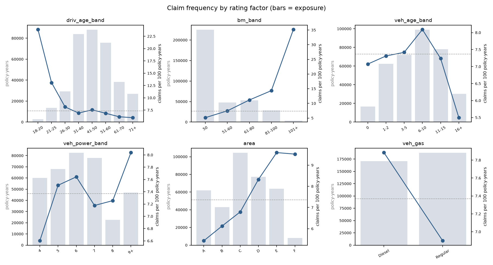
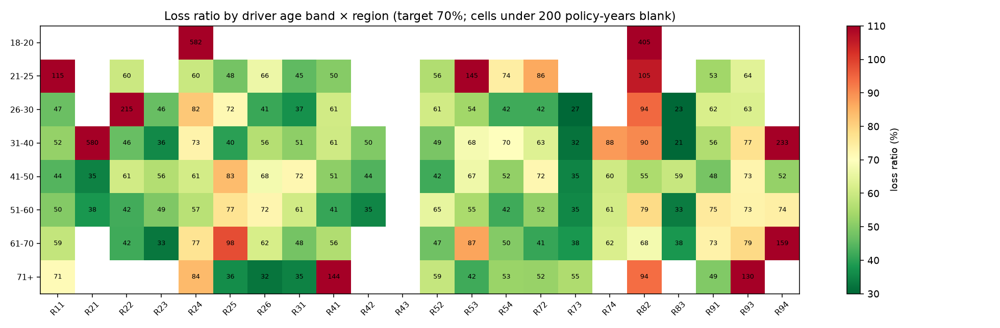

# Exploratory analysis

678,013 policies, 358,360 policy-years, 26,405 claims (**7.37 claims per 100 policy-years**), losses 59,909,216. Portfolio loss ratio against the assumed tariff: 73.5%.

> The data has no premiums. Loss ratios use an assumed simple tariff (see `src/tariff.py`) with gross premium = risk premium / 70%, so the portfolio loss ratio is close to 70% by construction. What matters is how segments differ.

## driv_age_band

| level | policies | exposure | claims | frequency | severity | loss_cost | loss_ratio |
|---|---|---|---|---|---|---|---|
| 18-20 | 6,816 | 2,585 | 617 | 0.2387 | 13,431 | 3,206.4 | 278.0% |
| 21-25 | 32,079 | 13,643 | 1,786 | 0.1309 | 2,251 | 294.7 | 75.8% |
| 26-30 | 65,594 | 29,167 | 2,379 | 0.0816 | 2,047 | 167.0 | 66.5% |
| 31-40 | 170,097 | 83,898 | 5,800 | 0.0691 | 2,144 | 148.2 | 69.5% |
| 41-50 | 165,185 | 88,100 | 6,660 | 0.0756 | 1,747 | 132.0 | 58.2% |
| 51-60 | 135,014 | 75,700 | 5,195 | 0.0686 | 1,863 | 128.8 | 61.5% |
| 61-70 | 63,863 | 38,321 | 2,358 | 0.0615 | 1,918 | 118.0 | 68.6% |
| 71+ | 39,365 | 26,947 | 1,610 | 0.0597 | 2,728 | 163.0 | 79.6% |

## bm_band

| level | policies | exposure | claims | frequency | severity | loss_cost | loss_ratio |
|---|---|---|---|---|---|---|---|
| 50 | 384,156 | 225,153 | 11,553 | 0.0513 | 1,922 | 99.0 | 64.9% |
| 51-60 | 94,446 | 47,958 | 3,576 | 0.0746 | 1,965 | 146.5 | 66.3% |
| 61-80 | 118,755 | 53,040 | 5,914 | 0.1115 | 2,069 | 230.7 | 67.4% |
| 81-100 | 72,862 | 28,638 | 4,106 | 0.1434 | 3,850 | 552.0 | 112.2% |
| 101+ | 7,794 | 3,571 | 1,256 | 0.3517 | 2,038 | 716.9 | 59.4% |

## veh_age_band

| level | policies | exposure | claims | frequency | severity | loss_cost | loss_ratio |
|---|---|---|---|---|---|---|---|
| 0 | 57,739 | 16,696 | 1,181 | 0.0707 | 1,986 | 140.4 | 61.0% |
| 1-2 | 130,408 | 62,442 | 4,566 | 0.0731 | 2,180 | 159.4 | 71.4% |
| 3-5 | 132,490 | 72,021 | 5,344 | 0.0742 | 1,975 | 146.5 | 67.1% |
| 6-10 | 171,594 | 98,974 | 8,008 | 0.0809 | 1,973 | 159.7 | 69.8% |
| 11-15 | 134,063 | 77,955 | 5,642 | 0.0724 | 3,135 | 228.4 | 96.7% |
| 16+ | 51,719 | 30,272 | 1,664 | 0.0550 | 2,069 | 113.7 | 49.8% |

## veh_power_band

| level | policies | exposure | claims | frequency | severity | loss_cost | loss_ratio |
|---|---|---|---|---|---|---|---|
| 4 | 115,349 | 60,055 | 3,965 | 0.0660 | 2,351 | 156.7 | 65.0% |
| 5 | 124,821 | 68,148 | 5,115 | 0.0751 | 1,728 | 129.7 | 55.6% |
| 6 | 148,976 | 82,498 | 6,305 | 0.0764 | 2,282 | 174.4 | 77.6% |
| 7 | 145,401 | 77,920 | 5,592 | 0.0718 | 2,222 | 159.5 | 71.6% |
| 8 | 46,956 | 22,674 | 1,645 | 0.0726 | 1,796 | 130.3 | 59.5% |
| 9+ | 96,510 | 47,065 | 3,783 | 0.0804 | 3,144 | 252.7 | 116.2% |

## area

| level | policies | exposure | claims | frequency | severity | loss_cost | loss_ratio |
|---|---|---|---|---|---|---|---|
| A | 103,957 | 61,957 | 3,364 | 0.0543 | 2,301 | 124.9 | 75.9% |
| B | 75,459 | 43,002 | 2,633 | 0.0612 | 3,370 | 206.4 | 115.4% |
| C | 191,880 | 104,403 | 7,093 | 0.0679 | 2,060 | 140.0 | 70.1% |
| D | 151,596 | 77,088 | 6,420 | 0.0833 | 2,243 | 187.9 | 71.8% |
| E | 137,167 | 63,786 | 6,121 | 0.0960 | 2,126 | 204.1 | 63.4% |
| F | 17,954 | 8,125 | 774 | 0.0953 | 1,524 | 145.2 | 57.5% |

## veh_gas

| level | policies | exposure | claims | frequency | severity | loss_cost | loss_ratio |
|---|---|---|---|---|---|---|---|
| Diesel | 332,136 | 170,588 | 13,449 | 0.0788 | 2,052 | 161.8 | 74.0% |
| Regular | 345,877 | 187,773 | 12,956 | 0.0690 | 2,487 | 172.1 | 73.2% |

## region

| level | policies | exposure | claims | frequency | severity | loss_cost | loss_ratio |
|---|---|---|---|---|---|---|---|
| R21 | 3,026 | 1,204 | 77 | 0.0639 | 6,250 | 399.6 | 183.1% |
| R94 | 4,516 | 1,766 | 132 | 0.0747 | 3,520 | 263.1 | 115.5% |
| R24 | 160,601 | 102,706 | 6,475 | 0.0630 | 2,946 | 185.7 | 94.2% |
| R82 | 84,752 | 45,333 | 4,233 | 0.0934 | 2,428 | 226.7 | 89.7% |
| R93 | 79,315 | 35,749 | 2,985 | 0.0835 | 2,301 | 192.2 | 76.4% |
| R22 | 7,994 | 3,573 | 314 | 0.0879 | 2,190 | 192.5 | 75.6% |
| R53 | 42,122 | 27,753 | 1,871 | 0.0674 | 2,085 | 140.6 | 68.5% |
| R25 | 10,893 | 6,653 | 452 | 0.0679 | 2,057 | 139.8 | 64.3% |
| R74 | 4,567 | 2,396 | 197 | 0.0822 | 1,423 | 117.0 | 62.9% |
| R41 | 12,990 | 8,112 | 468 | 0.0577 | 2,210 | 127.5 | 62.2% |
| R91 | 35,805 | 14,711 | 1,030 | 0.0700 | 1,902 | 138.1 | 60.0% |
| R26 | 10,492 | 5,023 | 345 | 0.0687 | 1,844 | 126.7 | 58.8% |
| R72 | 31,329 | 14,316 | 1,055 | 0.0737 | 1,816 | 133.8 | 58.8% |
| R43 | 1,326 | 564 | 38 | 0.0674 | 2,014 | 135.8 | 57.1% |
| R54 | 19,046 | 11,163 | 800 | 0.0717 | 1,631 | 116.9 | 54.0% |
| R31 | 27,285 | 11,488 | 944 | 0.0822 | 1,732 | 142.3 | 53.7% |
| R11 | 69,791 | 30,198 | 2,591 | 0.0858 | 1,761 | 151.1 | 53.3% |
| R52 | 38,751 | 21,930 | 1,576 | 0.0719 | 1,631 | 117.2 | 52.0% |
| R23 | 8,784 | 3,177 | 220 | 0.0693 | 1,489 | 103.1 | 44.7% |
| R42 | 2,200 | 1,209 | 92 | 0.0761 | 1,320 | 100.5 | 39.6% |
| R83 | 5,287 | 2,322 | 141 | 0.0607 | 1,305 | 79.2 | 37.0% |
| R73 | 17,141 | 7,014 | 369 | 0.0526 | 1,462 | 76.9 | 34.3% |

## veh_brand

| level | policies | exposure | claims | frequency | severity | loss_cost | loss_ratio |
|---|---|---|---|---|---|---|---|
| B11 | 13,585 | 6,883 | 664 | 0.0965 | 3,357 | 323.8 | 143.5% |
| B2 | 159,861 | 94,824 | 6,804 | 0.0718 | 2,763 | 198.3 | 90.4% |
| B10 | 17,707 | 9,490 | 765 | 0.0806 | 2,200 | 177.4 | 83.5% |
| B13 | 12,178 | 6,768 | 539 | 0.0796 | 2,155 | 171.6 | 78.7% |
| B4 | 25,179 | 13,770 | 1,099 | 0.0798 | 2,317 | 184.9 | 77.0% |
| B3 | 53,395 | 28,576 | 2,429 | 0.0850 | 2,140 | 181.9 | 75.4% |
| B1 | 162,736 | 95,315 | 6,860 | 0.0720 | 2,097 | 151.7 | 68.3% |
| B5 | 34,753 | 19,984 | 1,662 | 0.0832 | 1,746 | 145.2 | 61.4% |
| B12 | 166,024 | 64,802 | 4,200 | 0.0648 | 2,083 | 135.0 | 57.0% |
| B6 | 28,548 | 15,677 | 1,252 | 0.0799 | 1,564 | 124.9 | 52.8% |
| B14 | 4,047 | 2,271 | 131 | 0.0577 | 1,693 | 97.7 | 45.2% |
