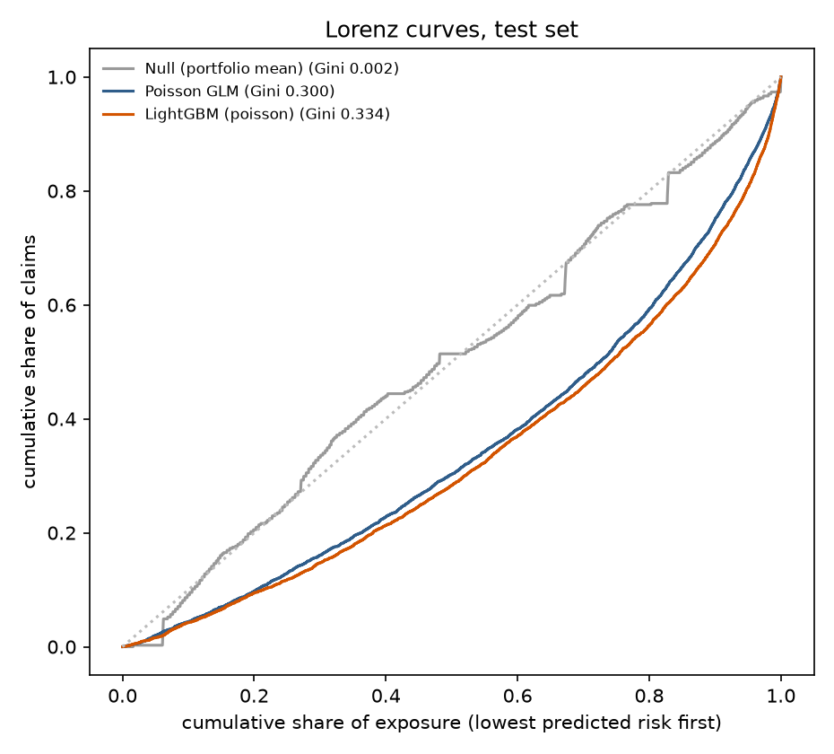

# Claim frequency

Train 541,904 policies / test 136,109 (split by hash of IDpol). Portfolio frequency 0.0740 claims per policy-year.

## GLM vs LightGBM on the test set

| model | poisson_deviance | deviance_explained | gini | predicted_claims | actual_claims |
|---|---|---|---|---|---|
| Null (portfolio mean) | 0.47169 | 0.00% | 0.0000 | 5,338 | 5,235 |
| Poisson GLM | 0.44794 | 5.04% | 0.3000 | 5,320 | 5,235 |
| LightGBM (poisson) | 0.43982 | 6.76% | 0.3342 | 5,319 | 5,235 |

**LightGBM's Gini is +11.4% relative to the GLM** (0.3342 vs 0.3000).

## Where the GLM misses (and LightGBM gets closer)

Two-way cells with ≥ 300 policy-years in the test set where actual claims differ from the GLM by more than 3.81 Poisson standard errors (Bonferroni across 366 cells) and LightGBM is closer to actual. These are candidate interaction terms to add to the GLM.

| cell | exposure | claims | glm | lgb | actual_vs_glm | actual_vs_lgb |
|---|---|---|---|---|---|---|
| driv_age_band=61-70 & bm_band=61-80 | 490 | 97 | 65.8 | 82.7 | 1.47 | 1.17 |

## GLM relativities (multiplicative, vs base level)

Base levels: driv_age_band = 41-50, bm_band = 50, veh_age_band = 6-10, veh_power_band = 6; other factors use the first level alphabetically. `log_density` is per unit of log density.

| term | relativity | ci_low | ci_high | p_value |
|---|---|---|---|---|
| driv_age_band = 18-20 | 1.251 | 1.132 | 1.382 | 1.03e-05 |
| driv_age_band = 21-25 | 0.726 | 0.681 | 0.774 | 1.84e-22 |
| driv_age_band = 26-30 | 0.575 | 0.543 | 0.607 | 5.08e-85 |
| driv_age_band = 31-40 | 0.701 | 0.673 | 0.730 | 4.6e-66 |
| driv_age_band = 51-60 | 0.967 | 0.929 | 1.007 | 0.109 |
| driv_age_band = 61-70 | 0.918 | 0.871 | 0.968 | 0.00165 |
| driv_age_band = 71+ | 0.964 | 0.906 | 1.026 | 0.249 |
| bm_band = 101+ | 7.787 | 7.261 | 8.350 | 0 |
| bm_band = 51-60 | 1.586 | 1.518 | 1.658 | 1.11e-93 |
| bm_band = 61-80 | 2.516 | 2.421 | 2.616 | 0 |
| bm_band = 81-100 | 3.216 | 3.067 | 3.372 | 0 |
| veh_age_band = 0 | 0.981 | 0.913 | 1.053 | 0.593 |
| veh_age_band = 1-2 | 1.020 | 0.976 | 1.066 | 0.379 |
| veh_age_band = 11-15 | 0.880 | 0.847 | 0.915 | 7.72e-11 |
| veh_age_band = 16+ | 0.696 | 0.656 | 0.739 | 2.72e-32 |
| veh_age_band = 3-5 | 0.988 | 0.950 | 1.028 | 0.555 |
| veh_power_band = 4 | 0.908 | 0.867 | 0.952 | 6.35e-05 |
| veh_power_band = 5 | 0.950 | 0.911 | 0.992 | 0.0188 |
| veh_power_band = 7 | 0.994 | 0.954 | 1.036 | 0.769 |
| veh_power_band = 8 | 1.038 | 0.976 | 1.104 | 0.236 |
| veh_power_band = 9+ | 1.179 | 1.123 | 1.238 | 2.82e-11 |
| area = B | 1.030 | 0.963 | 1.101 | 0.395 |
| area = C | 1.071 | 0.983 | 1.167 | 0.117 |
| area = D | 1.134 | 0.997 | 1.291 | 0.0563 |
| area = E | 1.150 | 0.968 | 1.366 | 0.111 |
| area = F | 1.169 | 0.921 | 1.482 | 0.199 |
| veh_gas = Regular | 0.860 | 0.835 | 0.886 | 6.41e-24 |
| veh_brand = B10 | 1.020 | 0.935 | 1.113 | 0.653 |
| veh_brand = B11 | 1.223 | 1.117 | 1.339 | 1.38e-05 |
| veh_brand = B12 | 0.784 | 0.746 | 0.824 | 1.11e-21 |
| veh_brand = B13 | 1.037 | 0.939 | 1.146 | 0.468 |
| veh_brand = B14 | 0.842 | 0.695 | 1.021 | 0.0797 |
| veh_brand = B2 | 1.015 | 0.977 | 1.054 | 0.449 |
| veh_brand = B3 | 1.034 | 0.980 | 1.090 | 0.221 |
| veh_brand = B4 | 1.022 | 0.951 | 1.098 | 0.557 |
| veh_brand = B5 | 1.083 | 1.019 | 1.150 | 0.0104 |
| veh_brand = B6 | 1.070 | 1.001 | 1.145 | 0.0479 |
| region = R21 | 1.011 | 0.782 | 1.307 | 0.933 |
| region = R22 | 1.154 | 1.009 | 1.319 | 0.0369 |
| region = R23 | 0.969 | 0.828 | 1.135 | 0.699 |
| region = R24 | 1.028 | 0.964 | 1.097 | 0.397 |
| region = R25 | 1.005 | 0.894 | 1.129 | 0.937 |
| region = R26 | 1.016 | 0.890 | 1.159 | 0.818 |
| region = R31 | 1.038 | 0.949 | 1.135 | 0.416 |
| region = R41 | 0.965 | 0.861 | 1.081 | 0.538 |
| region = R42 | 1.017 | 0.800 | 1.293 | 0.889 |
| region = R43 | 1.022 | 0.719 | 1.452 | 0.903 |
| region = R52 | 1.051 | 0.973 | 1.136 | 0.207 |
| region = R53 | 0.989 | 0.915 | 1.068 | 0.769 |
| region = R54 | 1.081 | 0.982 | 1.190 | 0.112 |
| region = R72 | 1.084 | 0.995 | 1.182 | 0.0655 |
| region = R73 | 0.776 | 0.683 | 0.881 | 8.91e-05 |
| region = R74 | 1.485 | 1.262 | 1.748 | 1.89e-06 |
| region = R82 | 1.214 | 1.139 | 1.293 | 1.88e-09 |
| region = R83 | 0.992 | 0.819 | 1.202 | 0.935 |
| region = R91 | 0.999 | 0.915 | 1.091 | 0.985 |
| region = R93 | 1.132 | 1.059 | 1.209 | 0.00026 |
| region = R94 | 1.195 | 0.984 | 1.452 | 0.0725 |
| log_density | 1.047 | 1.014 | 1.082 | 0.00536 |