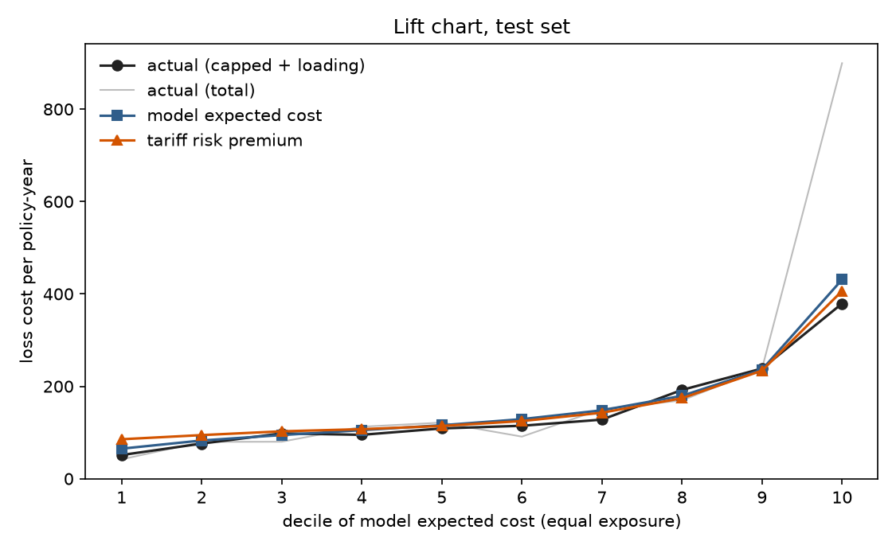
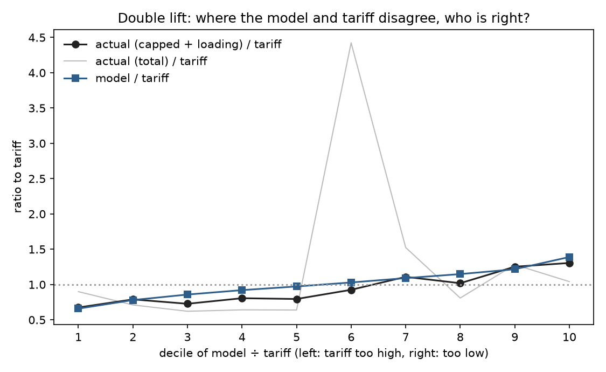

# Pricing and mispriced segments

Expected cost per policy-year = Poisson GLM frequency × Gamma GLM capped severity × (1 + large-claim loading), rebalanced to training losses.

Current tariff (assumed, the data has no premiums): **glm** relativities on bm_band, driv_age_band, area, from capped training losses, rebalanced to total losses. See `src/tariff.py`.

- Large-claim loading: **25.8%** (excess above the cap, as a share of capped losses, training data).
- Balance factor: 1.0014.

## Does the model rank risk better than the tariff? (test set)

Gini of each price measured against what happened in the test year. Capped losses is the fair comparison: total losses include a few very large claims that no rating factor predicts.

| price | Gini on claim counts | **Gini on capped losses** | Gini on total losses |
|---|---|---|---|
| Assumed 3-factor tariff | 0.2841 | **0.3051** | 0.4902 |
| GLM pure premium | 0.2989 | **0.3179** | 0.4937 |
| same, with LightGBM frequency | 0.3330 | **0.3582** | 0.5197 |

Read the double lift chart from left to right: on the left the model says the tariff charges too much, on the right too little. If the black line (what actually happened, with each policy's large-claim excess replaced by the average loading) follows the blue one, the model is right.

## Mispriced segments

Segments: driv_age_band × bm_band × veh_age_band × veh_gas (476 segments, 150 with ≥ 500 policy-years). Mispriced = model expected cost differs from the tariff by more than 10%.

**50.7% of policies are in mispriced segments**: 33.8% under-priced and 16.9% over-priced (58.1% of the 591,886 policies in segments big enough to judge). The under-priced segments are short 2,485,551 of risk premium, 4.4% of the portfolio total.

### Did it hold up out of sample?

Test-set policies grouped by their segment's status. If the model is right, under-priced groups should cost more than the tariff charged (ratio above 1) and over-priced groups less. 'Capped' replaces each policy's large-claim excess with the average loading, which is what a price can be expected to predict.

| group (test set) | policy-years | claims | model ÷ tariff | **actual (capped) ÷ tariff** | actual (total) ÷ tariff |
|---|---|---|---|---|---|
| under-priced | 23,505 | 1,681 | 1.16 | **1.11** | 1.01 |
| over-priced | 13,796 | 739 | 0.81 | **0.67** | 2.63 |
| fair | 27,264 | 1,762 | 0.98 | **0.93** | 0.95 |
| too small to judge | 7,603 | 1,053 | 0.99 | **0.93** | 0.88 |

Segment by segment, the model was closer than the tariff to test-set losses in 52% of mispriced segments: one year of losses per segment is too noisy to settle it individually, hence the pooled check.

| status | segments | policies | share of policies | share of exposure | premium gap |
|---|---|---|---|---|---|
| under-priced | 50 | 229,076 | 33.8% | 32.6% | 2,485,551 |
| over-priced | 37 | 114,539 | 16.9% | 19.0% | -1,939,304 |
| fair | 63 | 248,271 | 36.6% | 37.9% | -398,647 |
| too small to judge | 326 | 86,127 | 12.7% | 10.4% | -142,933 |

### Most under-priced (largest premium gap)

| segment | policies | exposure | claims | model_vs_tariff | actual_vs_tariff | loss_ratio | premium_gap |
|---|---|---|---|---|---|---|---|
| 41-50 · 50 · 6-10 · Diesel | 15,803 | 9,849 | 616 | 1.15 | 0.91 | 63.6% | 164,796 |
| 51-60 · 50 · 6-10 · Diesel | 12,785 | 8,324 | 474 | 1.15 | 0.97 | 67.6% | 142,579 |
| 41-50 · 50 · 3-5 · Diesel | 12,526 | 7,125 | 447 | 1.15 | 1.40 | 98.0% | 123,126 |
| 51-60 · 50 · 3-5 · Diesel | 11,047 | 6,454 | 373 | 1.16 | 0.85 | 59.2% | 112,697 |
| 41-50 · 50 · 1-2 · Diesel | 13,551 | 6,570 | 429 | 1.13 | 0.93 | 65.1% | 96,243 |
| 51-60 · 50 · 1-2 · Diesel | 13,115 | 6,587 | 412 | 1.13 | 1.06 | 74.2% | 95,769 |
| 31-40 · 61-80 · 6-10 · Diesel | 6,563 | 2,911 | 343 | 1.15 | 2.33 | 162.9% | 95,369 |
| 31-40 · 50 · 6-10 · Diesel | 10,205 | 6,501 | 293 | 1.16 | 0.77 | 54.1% | 79,774 |
| 61-70 · 50 · 6-10 · Diesel | 5,462 | 3,897 | 196 | 1.20 | 1.47 | 102.9% | 71,553 |
| 31-40 · 51-60 · 6-10 · Diesel | 6,879 | 3,442 | 248 | 1.15 | 0.84 | 59.0% | 69,053 |
| 26-30 · 61-80 · 6-10 · Diesel | 4,894 | 2,178 | 191 | 1.17 | 1.49 | 104.2% | 64,976 |
| 21-25 · 81-100 · 6-10 · Diesel | 2,661 | 1,071 | 187 | 1.22 | 0.83 | 58.1% | 63,695 |

### Most over-priced

| segment | policies | exposure | claims | model_vs_tariff | actual_vs_tariff | loss_ratio | premium_gap |
|---|---|---|---|---|---|---|---|
| 41-50 · 50 · 11-15 · Regular | 13,158 | 8,262 | 460 | 0.83 | 0.70 | 49.1% | -159,044 |
| 41-50 · 50 · 16+ · Regular | 6,104 | 3,881 | 122 | 0.65 | 0.38 | 26.6% | -153,720 |
| 51-60 · 50 · 16+ · Regular | 5,253 | 3,577 | 96 | 0.65 | 0.58 | 40.5% | -140,294 |
| 51-60 · 50 · 11-15 · Regular | 10,443 | 6,985 | 386 | 0.84 | 0.84 | 58.7% | -130,936 |
| 71+ · 50 · 16+ · Regular | 2,601 | 2,155 | 58 | 0.68 | 2.30 | 160.8% | -80,738 |
| 31-40 · 61-80 · 11-15 · Regular | 4,892 | 2,339 | 189 | 0.85 | 1.24 | 87.0% | -80,180 |
| 31-40 · 61-80 · 16+ · Regular | 2,137 | 979 | 66 | 0.66 | 0.48 | 33.9% | -74,176 |
| 18-20 · 81-100 · 11-15 · Regular | 1,583 | 591 | 136 | 0.85 | 16.00 | 1120.2% | -64,634 |
| 61-70 · 50 · 16+ · Regular | 2,746 | 2,045 | 54 | 0.68 | 0.51 | 35.5% | -63,066 |
| 31-40 · 50 · 11-15 · Regular | 6,990 | 4,568 | 127 | 0.84 | 0.74 | 51.7% | -60,475 |
| 31-40 · 51-60 · 11-15 · Regular | 4,905 | 2,668 | 127 | 0.84 | 0.71 | 49.5% | -56,684 |
| 41-50 · 61-80 · 11-15 · Regular | 2,329 | 1,118 | 171 | 0.85 | 0.78 | 54.5% | -56,298 |